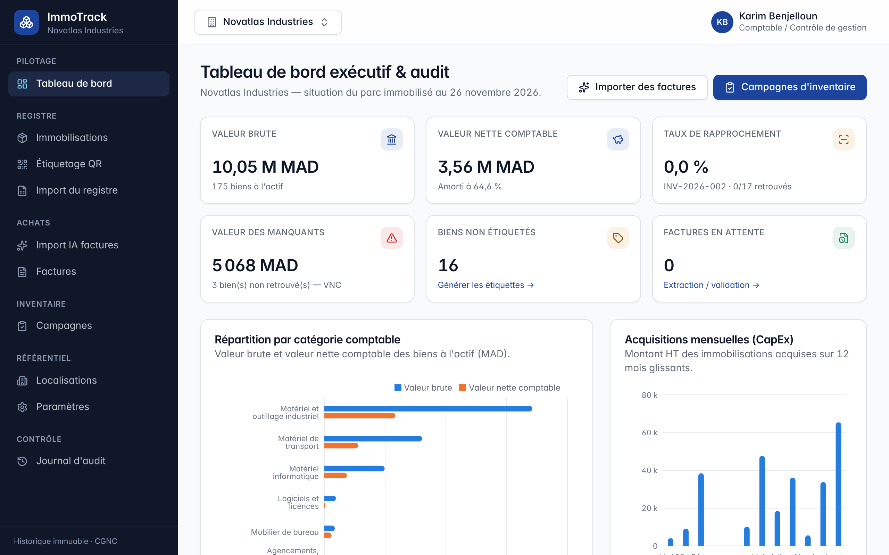
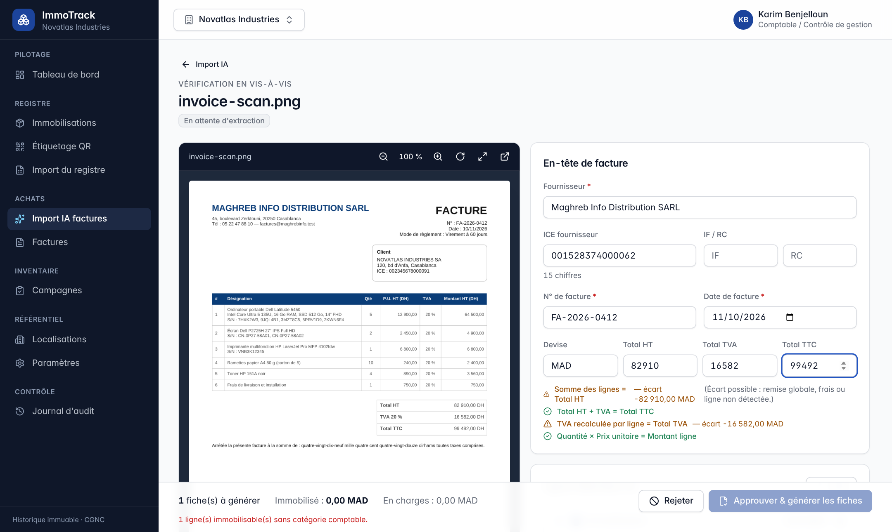
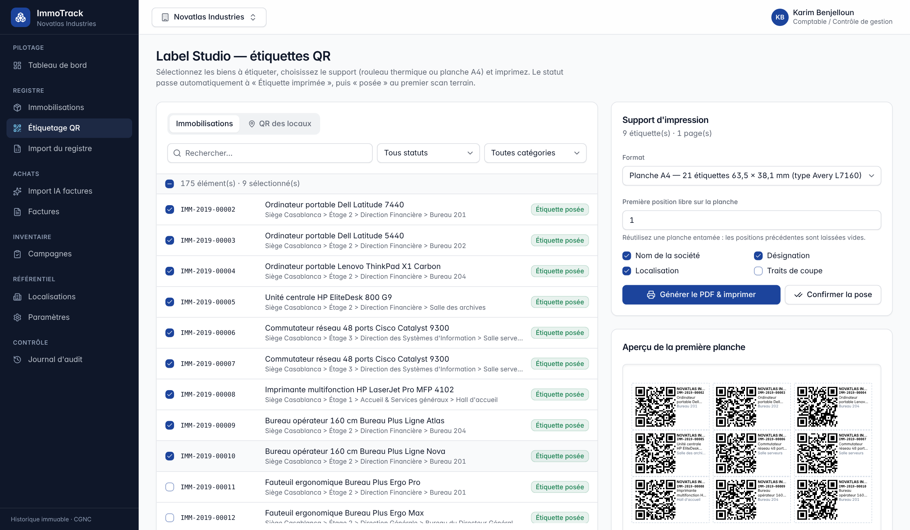
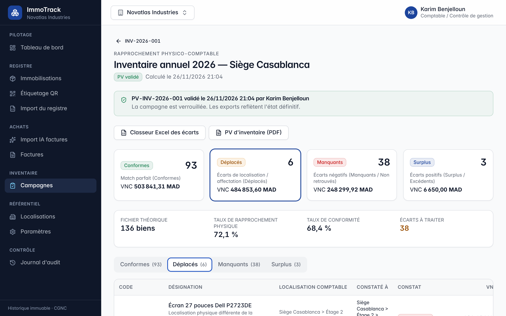
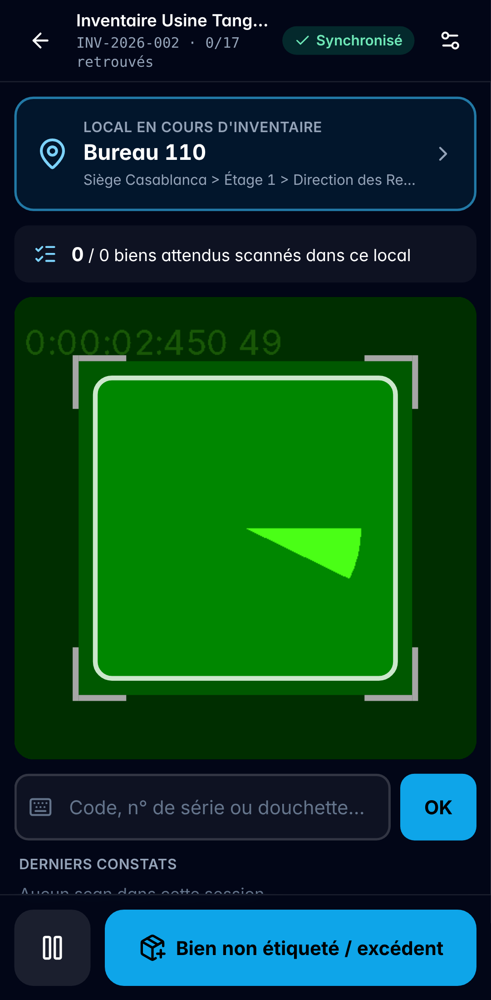

# ImmoTrack — Gestion d'inventaire physique des immobilisations

Plateforme EAM / Fixed Asset complète : **registre des immobilisations** (plan d'amortissement CGNC, VNC),
**extraction IA des factures fournisseurs** (Google Gemini 2.5 Flash, sortie JSON structurée),
**étiquetage QR** (rouleaux thermiques et planches A4), **inventaire terrain sur smartphone** (scan caméra,
mode hors ligne) et **rapprochement physico-comptable** avec exports officiels (classeur Excel des écarts,
PV d'inventaire PDF, balance des immobilisations).

Interface en français, montants en MAD par défaut, multi-sociétés.

| Tableau de bord | Vérification IA en vis-à-vis |
|---|---|
|  |  |
| **Label Studio (étiquettes QR)** | **Rapprochement physico-comptable** |
|  |  |

<p align="center"><br><em>Mode terrain sur smartphone</em></p>

---

## Sommaire

1. [Fonctionnalités](#fonctionnalités)
2. [Stack technique](#stack-technique)
3. [Installation](#installation)
4. [Comptes de démonstration](#comptes-de-démonstration)
5. [Architecture](#architecture)
6. [Modèle de données](#modèle-de-données)
7. [Moteur d'extraction IA (Gemini)](#moteur-dextraction-ia-gemini)
8. [Règles comptables](#règles-comptables)
9. [Sécurité & traçabilité](#sécurité--traçabilité)
10. [Tests & qualité](#tests--qualité)
11. [Mise en production](#mise-en-production)
12. [Limites connues](#limites-connues)

---

## Fonctionnalités

| Module | Route | Contenu |
|---|---|---|
| Tableau de bord | `/dashboard` | Valeur brute, VNC, taux de rapprochement, valeur des manquants, biens non étiquetés, factures en attente ; répartition par catégorie, CapEx mensuel, avancement de campagne par site / étage |
| Registre | `/assets`, `/assets/[id]` | Fiche complète (code `IMM-2026-00042`, n° de série, fournisseur, facture, mise en service, méthode, durée, cumul, VNC), plan d'amortissement, historique immuable, transfert, affectation nominative **avec signature électronique** et décharge PDF, changement de statut, sortie d'actif (cession / destruction) |
| Import du registre | `/assets/import` | Reprise du fichier comptable existant (Excel / CSV) : modèle téléchargeable, contrôle ligne à ligne, import transactionnel |
| Export balance | bouton « Export balance » | Classeur Excel : balance par compte CGNC + fichier des immobilisations, arrêté à date |
| Label Studio | `/assets/labels` | Sélection des biens (ou des locaux), formats thermiques 50×25, 57×32, 40×30, 100×50 mm et planches A4 (types Avery L7651, L7160, L7163, 3474) ou format personnalisé, position de départ sur planche entamée, aperçu, PDF prêt à imprimer |
| Import IA factures | `/invoices/import` | Glisser-déposer PDF / JPG / PNG / WebP / HEIC par lots de 20, extraction Gemini en parallèle, détection des doublons (empreinte SHA-256) |
| Vérification en vis-à-vis | `/invoices/import/[id]` | Document à gauche (PDF natif ou image avec zoom / rotation), données à droite : en-tête, contrôles arithmétiques recalculés en direct, lignes immobilisables vs charges, catégorie comptable, **scission d'une ligne de N unités en N fiches** avec répartition des n° de série, approbation |
| Localisations | `/locations` | Arborescence Site › Bâtiment › Étage › Direction › Bureau, QR de local |
| Campagnes | `/campaigns` | Périmètre (localisations, catégories), équipe, **gel du fichier comptable théorique** au lancement, suivi d'avancement |
| Mode terrain | `/campaigns/[id]/scan` | Interface mobile à fort contraste : choix du local (ou scan de son QR), scan caméra (html5-qrcode) ou douchette, retour sonore et haptique, état physique, photo obligatoire si endommagé, proposition de transfert automatique, saisie des **biens non étiquetés / excédents** avec étiquette provisoire `TMP-…`, file d'attente **hors ligne** (IndexedDB) |
| Rapprochement | `/campaigns/[id]/reconcile` | Classement en 4 catégories (Conformes, Déplacés, Manquants, Surplus), régularisations en masse (synchronisation des localisations, déclaration de disparition, intégration d'excédents, passage en maintenance, justification), exports Excel / PDF, validation et verrouillage du PV |
| Paramètres | `/settings` | Société (ICE, IF, RC, seuil d'immobilisation, exercice), catégories CGNC, centres de coût, directions, collaborateurs, fournisseurs, utilisateurs & habilitations |
| Journal d'audit | `/audit` | Tous les événements, filtrables, avec utilisateur, campagne, GPS et IP |

## Stack technique

| Couche | Choix (versions figées dans `package.json`) |
|---|---|
| Framework | Next.js **15.5** (App Router, Server Components, Server Actions, Route Handlers), React 19.2, TypeScript 5.9 |
| UI | Tailwind CSS 3.4, composants shadcn/ui (Radix), Lucide, Sonner, Recharts 2.15 |
| Données | PostgreSQL 14+ · Prisma ORM 6.19 |
| IA | `@google/genai` 3.6 — modèle `gemini-2.5-flash`, `responseSchema` |
| QR / scan | `qrcode.react` (génération), `html5-qrcode` (lecture caméra + BarcodeDetector natif) |
| Exports | `jspdf` 4 + `jspdf-autotable` 5 (étiquettes, PV, décharge), `xlsx` / SheetJS (classeurs) |
| Auth | Session JWT HS256 signée (`jose`) en cookie httpOnly, mots de passe `bcryptjs` |
| Validation | Zod |
| Tests | Vitest |

Les versions majeures retenues (Next 15, Prisma 6, Tailwind 3, Recharts 2) sont les lignes stables les plus
éprouvées au moment de l'écriture, en dernière version corrective.

## Installation

### Prérequis

- **Node.js ≥ 22** (requis par `@google/genai` 3.x)
- **PostgreSQL ≥ 14** — ou Docker pour utiliser `docker-compose.yml`
- Une clé API Gemini (https://aistudio.google.com/apikey) pour l'extraction IA (facultative : sans clé, les
  factures sont saisies manuellement dans le même écran de vérification)

### Étapes

```bash
# 1. Dépendances (le script postinstall génère le client Prisma)
npm install

# 2. Configuration
cp .env.example .env
#   - AUTH_SECRET     : openssl rand -base64 48
#   - DATABASE_URL    : chaîne de connexion PostgreSQL
#   - GEMINI_API_KEY  : clé Google AI Studio
#   - NEXT_PUBLIC_APP_URL : URL publique (encodée dans les QR codes)

# 3. Base de données (PostgreSQL local via Docker, ou votre propre instance)
docker compose up -d
npm run db:deploy        # applique les migrations (tables + triggers d'immutabilité)
npm run db:seed          # données de démonstration (facultatif)

# 4. Lancement
npm run dev              # http://localhost:3000
```

Le seed génère aussi une **facture fournisseur PDF réaliste** (`samples/Facture_MaghrebInfo_FA-2026-0412.pdf`,
déjà déposée dans « Import IA factures ») : cliquez sur « Extraire » pour tester Gemini immédiatement.

### Scripts utiles

| Commande | Effet |
|---|---|
| `npm run dev` | Serveur de développement |
| `npm run build` / `npm start` | Build et serveur de production |
| `npm run db:migrate` | Crée / applique une migration en développement |
| `npm run db:deploy` | Applique les migrations (CI / production) |
| `npm run db:seed` | Réinitialise et charge les données de démonstration |
| `npm run db:reset` | Recrée la base, puis exécute le seed |
| `npm test` | Tests unitaires (Vitest) |
| `npm run typecheck` / `npm run lint` | Contrôles statiques |

## Comptes de démonstration

Mot de passe commun : **`Demo@2026!`**

| E-mail | Profil | Droits |
|---|---|---|
| `admin@novatlas.test` | Administrateur | Tout, dont utilisateurs et paramètres société ; accès aux 2 sociétés |
| `comptable@novatlas.test` | Comptable | Registre, factures, campagnes, régularisations, validation du PV |
| `auditeur@novatlas.test` | Inventoriste | Mode terrain, étiquetage, consultation |
| `lecture@novatlas.test` | Lecture seule | Consultation |

Les sociétés, personnes et fournisseurs du jeu de démonstration sont fictifs.

## Architecture

```
prisma/
  schema.prisma            Modèle de données complet (24 tables, enums, index)
  migrations/              SQL versionné + triggers « ajout seul » du journal d'audit
  seed.ts                  Jeu de démonstration (et facture PDF d'exemple)
src/
  middleware.ts            Garde d'authentification (Edge) : redirection /login ou 401 JSON
  lib/
    gemini-invoice-extractor.ts   Moteur d'extraction IA (SDK officiel @google/genai)
    invoice-normalization.ts      Validation Zod + normalisation + contrôles arithmétiques (partagé client/serveur)
    depreciation.ts               Plan d'amortissement linéaire / dégressif, VNC à date
    reconciliation.ts             Classement physico-comptable en 4 catégories
    codes.ts                      Codes IMM / TMP / INV, analyse des QR scannés
    labels.ts                     Gabarits d'étiquettes (mm)
    permissions.ts                Matrice des droits par profil
    validators.ts                 Schémas Zod de toutes les entrées
    exports/                      Générateurs client : étiquettes PDF, PV PDF, décharge PDF, classeurs Excel
    client/                       File hors ligne IndexedDB, retour sonore/haptique, compression photo
    server/                       Auth, stockage fichiers, séquences, audit, services terrain, requêtes de pages
  actions/                 Server Actions (immobilisations, factures, campagnes, rapprochement, référentiels…)
  app/
    (app)/…                Pages back-office (shell avec barre latérale ; /campaigns/[id]/scan en plein écran)
    a/[code]               Lien profond encodé dans les QR (ouvre la fiche avec n'importe quel smartphone)
    api/                   Upload / extraction de factures, scans, excédents, fichiers, santé
  components/              UI (shadcn/ui) et composants métier
tests/                     Tests unitaires Vitest
```

### API (Route Handlers)

| Méthode | Route | Rôle |
|---|---|---|
| `POST` | `/api/invoices/upload` | Dépôt multi-fichiers (type vérifié par signature binaire, doublons SHA-256) |
| `POST` | `/api/invoices/[id]/extract` | Extraction Gemini (verrou optimiste, statut `EXTRACTING` → `EXTRACTED` / `FAILED`) |
| `GET` | `/api/campaigns/[id]/snapshot` | Fichier théorique compact pour l'appariement local sur le terrain |
| `GET` | `/api/campaigns/[id]/lookup?code=` | Résolution d'un code hors fichier théorique (hors périmètre, sorti d'actif, inconnu) |
| `POST` | `/api/campaigns/[id]/scans` | Enregistrement **idempotent** d'un scan (`clientId` généré sur l'appareil) |
| `POST` | `/api/campaigns/[id]/surplus` | Saisie d'un excédent (conversion automatique en scan si le code existe) |
| `POST` | `/api/uploads` | Photos terrain |
| `GET` | `/api/files/[...key]` | Fichiers, réservés aux membres de la société propriétaire |
| `GET` | `/api/health` | Sonde de disponibilité (base de données) |

## Modèle de données

- **Multi-entités** : chaque table métier porte `companyId` ; un utilisateur peut appartenir à plusieurs
  sociétés (sélecteur dans l'en-tête) et chaque identifiant reçu est revérifié côté serveur.
- **Localisations** : arbre avec chemin matérialisé (`path`, `pathIds`) — un sous-arbre complet se requête
  par préfixe indexé.
- **Asset** : fiche immobilisation ; l'amortissement n'est pas stocké mais **recalculé à date** à partir de la
  méthode, de la durée et des dates (aucune désynchronisation possible).
- **AssetEvent** : journal immuable (création, transfert, affectation, statut, état, étiquetage, scan, sortie,
  régularisation) avec utilisateur, IP, campagne et GPS.
- **CustodianAssignment** : affectations nominatives, signature PNG, horodatage et IP du signataire.
- **Invoice / InvoiceLine** : pièce justificative, données extraites brutes, lignes validées, lien vers les
  fiches générées.
- **InventoryCampaign** → **CampaignSnapshotItem** (fichier théorique figé, VNC au lancement) →
  **CampaignScan** (constats, ajout seul) / **CampaignSurplus** (excédents) → **ReconciliationResult**
  (rapprochement recalculable, régularisations conservées entre deux calculs).
- **Sequence** : compteurs sans trou (`INSERT … ON CONFLICT DO UPDATE … RETURNING`) pour les codes
  `IMM-AAAA-NNNNN`, `INV-AAAA-NNN`, `TMP-AAAA-NNNNN`, `PV-INV-AAAA-NNN`.

## Moteur d'extraction IA (Gemini)

`src/lib/gemini-invoice-extractor.ts` :

1. **Ingestion** : fichier ≤ 14 Mo envoyé en ligne (base64) ; au-delà, téléversement via l'API Files de
   Gemini, attente de l'état `ACTIVE`, suppression après usage.
2. **Sortie structurée** : `responseMimeType: "application/json"` + `responseSchema` strict. L'énumération des
   catégories est **construite dynamiquement** à partir des catégories CGNC de la société, plus
   `NON_IMMOBILISABLE` pour les consommables, services et frais.
3. **Prompt système** : règles d'extraction (formats marocains, ICE / IF / RC, devises, n° de série,
   remises) et règles de classification (immobilisation vs charge, seuil d'immobilisation de la société).
4. **Robustesse** : nouvelles tentatives avec temporisation exponentielle (429, 5xx, réseau, délai dépassé,
   réponse vide ou JSON invalide), erreurs explicites (contenu bloqué, réponse tronquée, clé ou modèle
   invalide).
5. **Défiance** : revalidation Zod, normalisation (« 12 900,00 DH » → 12900, 0,2 → 20 %, dates européennes),
   déduction des montants manquants, contrôles Σ lignes = HT, HT + TVA = TTC, TVA par ligne,
   quantité × PU — recalculés en direct dans l'écran de vérification.

Rien n'est créé dans le registre sans validation humaine.

## Règles comptables

- **Linéaire** : prorata temporis en jours, base 360 (30E/360), depuis la date de mise en service.
- **Dégressif** : coefficients fiscaux marocains (1,5 pour 3–4 ans ; 2 pour 5–6 ans ; 3 au-delà), départ au
  1er jour du mois d'acquisition, bascule en linéaire dès que l'annuité linéaire sur la durée résiduelle
  l'emporte.
- **Sortie d'actif** : dotation jusqu'à la date de sortie, VNC et plus / moins-value tracées.
- Exercice décalé supporté (mois de début paramétrable par société).
- Comptes par défaut du jeu de démonstration (CGNC) : 2355 / 28355 matériel informatique, 2351 mobilier,
  2352 matériel de bureau, 2340 matériel de transport, 2332 matériel et outillage, 2356 agencements, 2220
  logiciels.

## Sécurité & traçabilité

- **Historique immuable** : triggers PostgreSQL rejetant tout `UPDATE` / `DELETE` sur `AssetEvent` et
  `CampaignScan`, quel que soit le client (application, console SQL, bug d'ORM).
- **RBAC** (`src/lib/permissions.ts`) appliqué aux pages, Server Actions et Route Handlers.
- **Cloisonnement** par société de chaque lecture et écriture ; fichiers servis uniquement aux membres de la
  société propriétaire ; clés de stockage validées (pas de traversée de répertoire).
- **Fichiers** : type réel vérifié par signature binaire (magic bytes), tailles plafonnées.
- **Sessions** : JWT HS256 en cookie httpOnly / SameSite=Lax / Secure en production ; limitation des tentatives
  de connexion ; temps de réponse constant pour un e-mail inconnu.
- **Idempotence** des scans terrain : une file hors ligne rejouée ne compte jamais deux fois.
- En-têtes HTTP : `X-Frame-Options`, `nosniff`, `Referrer-Policy`, `Permissions-Policy` (caméra et
  géolocalisation limitées à l'origine).

## Tests & qualité

```bash
npm test            # 31 tests : amortissement, rapprochement, codes QR, normalisation IA, schéma Gemini
npm run typecheck
npm run lint
npm run build
```

## Mise en production

- **HTTPS obligatoire** pour l'accès caméra des navigateurs mobiles (mode terrain) et pour le cookie `Secure`.
- `NEXT_PUBLIC_APP_URL` est encodé dans les QR : fixez l'URL définitive **avant** d'imprimer les étiquettes.
- `STORAGE_DIR` doit être un volume persistant et sauvegardé (factures, photos, signatures).
- Proxy inverse : autoriser des corps de requête d'au moins 25 Mo (dépôt de factures) et un délai de 300 s
  pour `/api/invoices/*/extract`.
- Migrations : `npm run db:deploy` à chaque déploiement.

## Limites connues

- **SheetJS** : le registre npm ne publie que `xlsx@0.18.5` ; SheetJS distribue les versions récentes sur son
  propre CDN. Les classeurs importés sont analysés **dans le navigateur** de l'utilisateur, jamais sur le
  serveur. Pour passer à la version 0.20.x, remplacez la dépendance par
  `"xlsx": "https://cdn.sheetjs.com/xlsx-0.20.3/xlsx-0.20.3.tgz"` (l'API est identique).
- **Stockage** : pilote disque local ; pour plusieurs instances, remplacez `putObject` / `getObject`
  (`src/lib/server/storage.ts`) par un stockage objet compatible S3.
- **Limitation des connexions** : en mémoire (par instance) ; utilisez un magasin partagé (Redis) en
  déploiement multi-instances.
- **Hors ligne** : la file d'attente couvre les coupures réseau une fois la page terrain chargée ; un service
  worker (PWA) serait nécessaire pour ouvrir l'application sans réseau.
